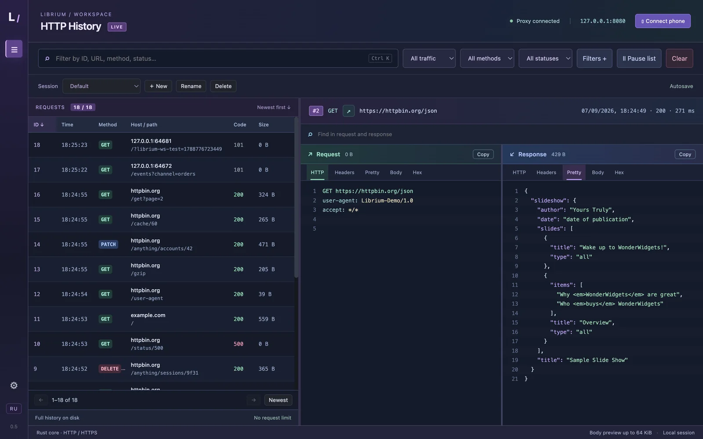
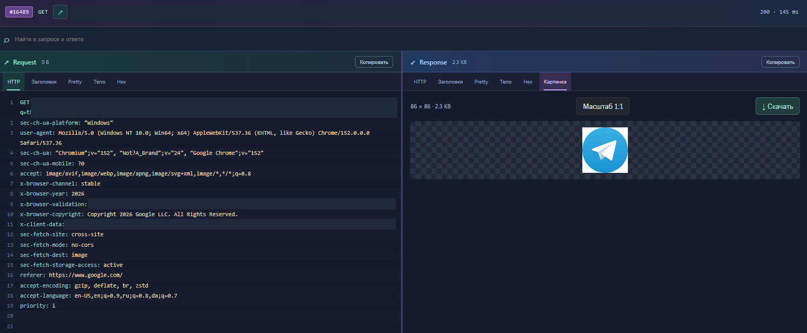

# Librium

**Смотри, что происходит между приложением и сетью.**

Librium — современный open-source инспектор HTTP, HTTPS и WebSocket для Windows. Прокси на Rust, полноценное десктопное приложение на Electron и история в SQLite: запросы, ответы, изображения, аудио и WebSocket-сообщения собраны в одном рабочем пространстве.

Разбирай API, отлаживай клиентские приложения, проверяй заголовки и изучай сетевое поведение. Цветной интерфейс помогает читать трафик, а сохранённые наборы фильтров — быстро возвращаться к нужной задаче.

**Rust + Electron · HTTP / HTTPS / WebSocket · SQLite · MIT**

[Возможности](#возможности) · [Скриншоты](#скриншоты) · [Установка](#установка) · [Настройка HTTPS](#подключение-https) · [Документация](#документация)

## Возможности

- HTTP/1.1 и HTTP/2 через явный прокси; HTTPS с локальным CA.
- История в SQLite без автоматического удаления по числу запросов.
- Поиск, фильтры HTTP/WebSocket, именованные сессии с автосохранением.
- Метки окна / Node worker и точный фильтр их записей во всём архиве, включая переход из инспектора одной кнопкой; одинаковые названия не смешивают разные контексты подключения.
- Список записанных окон и потоков: поиск по последнему названию, счётчики HTTP / WS, страницы одного снимка и выбор контекста для фильтрации истории.
- Сортировка всей истории по ID, методу, адресу, коду и размеру.
- Request и Response рядом: заголовки, текст, JSON, Hex, поиск и копирование URL.
- Просмотр PNG, SVG и других изображений, масштаб 1:1 и перетаскивание.
- Аудиоплеер и сохранение захваченных медиа в файл.
- WebSocket-сообщения в обе стороны: текст, бинарные данные, время и история. Соседние пакеты одного соединения доступны из инспектора, включая старые записи вне текущей страницы.
- Исследование содержимого WS: признаки форматов по всей записи, счётчики направлений, старые примеры и подсказки для начала разбора. Из группы можно открыть все её сообщения и искать их по всему архиву.
- Команды и ответы JSON-RPC 2.0: пакетные сообщения, точные числовые и строковые ID, переход к нужному элементу и явные неоднозначности. Структурный поиск методов и типизированных ID работает внутри пакетов по всему архиву.
- Поиск WS по всем соединениям и переподключениям: JSON, Socket.IO, MessagePack, Protobuf, Hex-маски и точные поля; открытие исходного пакета из результата.
- Подключение окон Electron / Chromium и сетевых событий главного процесса Node.js одновременно; запуск выбранного приложения / проекта Electron (включая Morphius) или установленного Majestic Launcher.
- Захват поддерживаемых HTTP / WS главного процесса с начала запуска, с автоматическим продолжением приложения после подготовки источника.
- Автоматический захват HTTP / WS из Node worker_threads, включая вложенные потоки, с отдельными метками worker и освобождением стартовой паузы при потере связи.
- Тела запросов fetch / Undici через диагностические события, включая JSON, бинарные данные и потоки; незавершённые и недоступные тела отмечаются явно.
- Разбор JSON / Engine.IO / Socket.IO, исходный текст и Hex; поиск по всей истории WS-сообщений. Список событий Socket.IO с частотами, namespace и переходом к точным совпадениям; поиск пары событие / ACK по всей записи.
- Свои схемы полей WS: имя, смещение, тип, LE / BE; точные 64-битные числа, Hex / UTF-8 и сохранение схем без значений трафика; точный поиск поля по всей записи соединения; перенос схем в JSON без значений сообщений и частотная сводка поля по всей записи и сравнение значений с пакетом-образцом.
- Опциональное подключение телефона в домашней сети.

## Скриншоты

История запросов и рабочая область:



Просмотр изображения в ответе. Параметры URL и служебные идентификаторы браузера скрыты:



## Установка

### Готовое приложение

Если для выбранной версии опубликована сборка, открой раздел **Releases** этого репозитория, скачай `Librium <версия>.exe` и запусти его. Portable-версия не требует установки Node.js или Rust. Для распакованной сборки сохраняй папку `win-unpacked` целиком.

Если готового релиза пока нет, собери приложение из исходников по инструкции ниже.

### Из исходников

Скачай исходники через **Code → Download ZIP** и распакуй архив либо клонируй репозиторий. Открой PowerShell в папке с `package.json` и `Cargo.toml`.

Нужны Windows, актуальный стабильный Rust, Node.js 24 или новее, Visual Studio Build Tools с инструментами C++ и Windows SDK. Для некоторых нативных зависимостей может понадобиться CMake.

```powershell
npm ci
npm run build:core
npm start
```

Чтобы получить portable-приложение:

```powershell
npm run dist
```

Результат находится в `dist/v<версия>/Librium <версия>.exe`.

Только Rust-ядро: `./run.ps1` или `cargo run --locked`. Интерфейс/API ядра слушает `127.0.0.1:3000`, прокси — `127.0.0.1:8080`.

## Быстрый старт

1. Запусти Librium и дождись подключения прокси.
2. В браузере или приложении укажи HTTP-прокси `127.0.0.1:8080`. Для HTTPS настрой доверие к локальному сертификату по инструкции ниже.
3. Открой страницу или выполни запрос — он появится в истории.
4. Выбери строку: слева отображается запрос, справа — ответ. Переключайся между заголовками, телом, Pretty и Hex; для медиа доступны просмотр, воспроизведение и скачивание.
5. Используй поиск и фильтры по типу трафика, методу и статусу. Сохрани набор в отдельную сессию фильтров, чтобы вернуться к нему после перезапуска.

Новые запросы по умолчанию появляются сверху. Нажатие на заголовок столбца меняет сортировку.

Для лаунчеров на Electron нажми **Подключить приложение → Выбрать приложение…**, укажи `.exe` или `package.json` проекта (например Morphius), закрой приложение и нажми **Запустить выбранное**. Путь сохраняется для следующих запусков. Для установленного Majestic Launcher есть отдельная кнопка. Одновременно подключаются окна и главный процесс Node.js; статусы показываются отдельно. Для этого режима сертификат CA не нужен. WS-сообщения доступны в источнике окон, для встроенного WebSocket Node.js и отдельно установленного пакета ws: в главном процессе Librium устанавливает временный наблюдатель, который снимается при отключении. Библиотеки, встроенные в bundle приложения, и нативные сокеты могут быть недоступны. Подробнее: [анализ трафика приложений](docs/custom-traffic.md).

В «Сообщениях WS» доступны Авто / JSON, MessagePack, исходное представление и Hex. MessagePack выбирается вручную для бинарного сообщения; большие целые сохраняют точность, неполные сообщения получают пояснение. Наличие этого режима не означает, что конкретный лаунчер использует MessagePack.

## Подключение HTTPS

При первом запуске Librium создаёт CA в `%LOCALAPPDATA%\Librium`. Укажи в нужном клиенте HTTP/HTTPS-прокси `127.0.0.1:8080` и добавь сертификат CA в доверенные сертификаты этого клиента. Настройка доступна в приложении.

Проверка без изменения системного хранилища сертификатов:

```powershell
curl.exe --ssl-revoke-best-effort --proxy http://127.0.0.1:8080 --cacert "$env:LOCALAPPDATA\Librium\ca.crt" https://example.com
```

Приложение не включает системный прокси и не устанавливает CA автоматически. После работы отключи прокси в клиенте. Приватный ключ `ca.key` никому не передавай.

Для телефона нажми «Подключить телефон», выбери локальный сетевой интерфейс и следуй инструкции. LAN-доступ включается отдельно; по умолчанию ядро доступно только на loopback.

### Подключение телефона

Подключи телефон и компьютер к одной домашней сети. В настройках Wi-Fi телефона укажи адрес компьютера, показанный Librium, и порт прокси `8080`. Для HTTPS установи локальный CA на телефон и включи доверие к нему, если этого требует система. Разреши входящие подключения Librium в брандмауэре Windows для частной сети.

После работы отключи прокси на телефоне. Некоторые приложения игнорируют системный прокси или не доверяют пользовательским сертификатам — их трафик может быть недоступен для просмотра.

## Если что-то не работает

| Симптом | Что проверить |
| --- | --- |
| В истории пусто | Клиент действительно использует прокси `127.0.0.1:8080`; активные фильтры не скрывают запросы. Сам запуск Librium не перенаправляет весь трафик Windows. |
| Ошибка сертификата HTTPS | Клиент доверяет CA, созданному этой копией Librium. В некоторых клиентах нужно явно указать файл сертификата. |
| `ECONNREFUSED 127.0.0.1:3000` | Rust-ядро не запущено или завершилось. Для запуска из исходников выполни `npm run build:core` и перезапусти приложение; проверь, что порт `3000` свободен. |
| Телефон не подключается | Устройства в одной сети, LAN-доступ включён, указан адрес компьютера, а брандмауэр разрешает соединения. |
| Вместо картинки ответ `301` или `302` | Это перенаправление. Открой захваченный запрос по адресу из `Location`: изображение находится в конечном ответе. |

## Хранение и ограничения

- История: `%LOCALAPPDATA%\Librium\history.sqlite3`, включая служебные WAL/SHM-файлы. Каталог можно изменить через `LIBRIUM_DATA_DIR`.
- Сессии фильтров и журналы: каталог данных Electron (`%APPDATA%\librium-desktop` при стандартном запуске).
- Для обычных HTTP-тел и каждого WebSocket-сообщения сохраняются первые 64 КиБ. Для изображений и аудио — до 32 МиБ. Сами данные передаются клиенту полностью.
- История записывается периодически и при штатном закрытии; при аварийном завершении последние изменения могут не сохраниться.
- HTTP/3/QUIC, прозрачный перехват всего трафика Windows и обход certificate pinning не реализованы. Клиент должен использовать прокси и доверять CA.

Используй Librium только для трафика, который имеешь право исследовать. История может содержать пароли, cookies и персональные данные: не включай её в репозиторий и публичные отчёты. Подробнее — [SECURITY.md](SECURITY.md).

## Проверки

```powershell
cargo test --locked
cargo clippy --locked --all-targets -- -D warnings
npm run test:ui
python scripts/export-source.py --check
```

Дополнительные проверки Electron и синтетических медиа описаны в [CONTRIBUTING.md](CONTRIBUTING.md).

## Подготовка исходников к публикации

```powershell
python scripts/export-source.py --check
python scripts/export-source.py
```

Экспорт создаёт новую папку `.publish/Librium` только с разрешёнными исходниками и двумя подготовленными скриншотами документации. В неё не копируются `.git`, локальные базы, сертификаты, трафик, логи, сборки и произвольные снимки экрана. Папка назначения должна быть новой или пустой. Если рабочая Git-история содержит личные данные, публикуй новую историю из чистого экспорта, а не исходный репозиторий.

## Документация

- [Архитектура](docs/architecture.md) — проектные заметки; возможности текущей версии перечислены выше.
- [Сеть](docs/network.md), [протоколы](docs/basics/protocols.md).
- [TLS](docs/basics/tls-versions.md), [сертификаты](docs/basics/certificates.md), [CA](docs/basics/certificate-authorities.md).
- [Настройка прокси](docs/proxy-setup.md), [учебные примеры](docs/practice.md).
- [Трафик приложений и кастомные WebSocket-протоколы](docs/custom-traffic.md) — Majestic Launcher, CDP, разбор сообщений и API адаптеров.

## Лицензия

Код Librium распространяется по [MIT License](LICENSE). Можно использовать проект, изменять его и распространять, в том числе в коммерческих продуктах, сохраняя уведомление об авторских правах и текст лицензии.

Сторонние зависимости и показанные в демонстрационных материалах сторонние изображения сохраняют собственные лицензии и права. Текст MIT: [Open Source Initiative](https://opensource.org/license/mit).

## Участие в проекте

Нашёл ошибку или придумал улучшение — создай Issue или предложи Pull Request. Для багов укажи версию Librium, шаги воспроизведения и ожидаемый результат. Прикладывай только обезличенные примеры без cookies, токенов и личного трафика.

Инструкции для разработки и проверок — в [CONTRIBUTING.md](CONTRIBUTING.md), рекомендации по работе с чувствительными данными — в [SECURITY.md](SECURITY.md).
